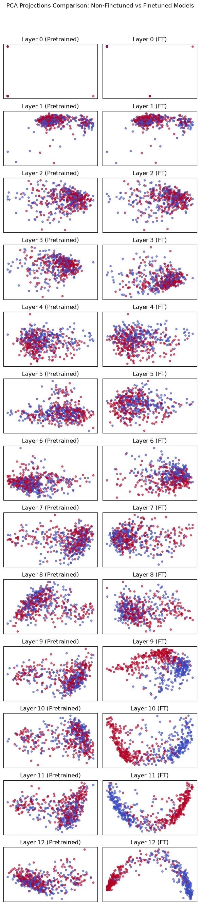
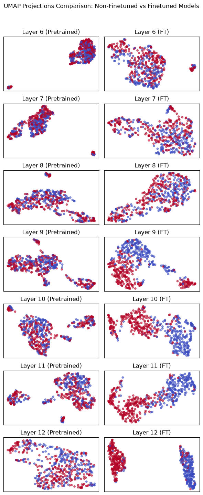
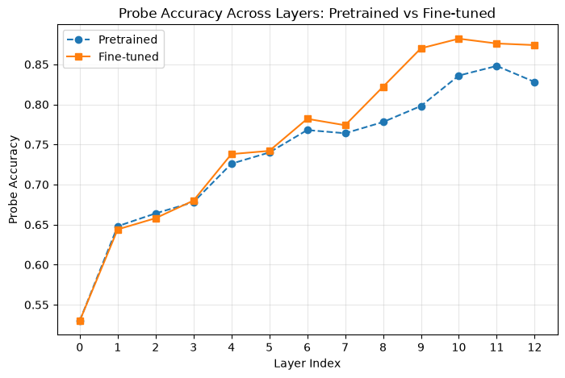
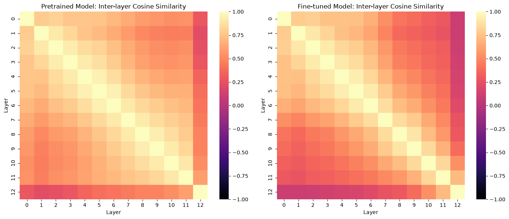

# Assignment 4 – Question 1: LLM Interpretability with BERT

## Overview

This assignment investigates how sentiment information is represented across the layers of a pretrained BERT model and how these representations change after fine-tuning.

Using the **SST-2** sentiment classification dataset, the experiment analyzes hidden representations through dimensionality reduction, linear probing, and inter-layer similarity comparisons.

## Assignment Information

| Item | Description |
|---|---|
| Dataset | SST-2 (GLUE) |
| Pretrained model | `bert-base-uncased` |
| Task | Binary sentiment classification |
| Training subset | 2,000 samples |
| Validation subset | 500 samples |
| Model architecture | 12 Transformer layers, hidden size 768 |

## Implemented Approaches

### 1. Dataset Preparation and Tokenization

- Loaded a subset of SST-2 containing 2,000 training and 500 validation examples.
- Tokenized sentences using the BERT tokenizer.
- Applied truncation and padding with a maximum sequence length of 128.
- Prepared PyTorch datasets and DataLoaders with a batch size of 32.

### 2. Pretrained BERT Representation Analysis

Extracted `[CLS]` representations from the embedding output and all 12 Transformer layers.

The following methods were used to investigate how sentiment information is encoded:

- **PCA:** Visualized representations from all 12 layers in two dimensions.
- **UMAP:** Examined the representations of layers 6–12.
- **Linear Probing:** Trained logistic regression classifiers on each layer's representations using five-fold cross-validation.

### 3. Fine-Tuning

Fine-tuned `BertForSequenceClassification` for binary sentiment classification.

| Parameter | Value |
|---|---|
| Epochs | 3 |
| Optimizer | AdamW |
| Learning rate | 2e-5 |
| Epsilon | 1e-8 |
| Gradient clipping | 1.0 |
| Number of classes | 2 |

### 4. Post-Fine-Tuning Analysis

Repeated the representation extraction and analysis procedures after fine-tuning.

The results were compared with the pretrained model using:

- PCA and UMAP visualizations.
- Layer-wise logistic regression probing.
- Inter-layer cosine similarity heatmaps.

## Visualizations

### PCA: Pretrained vs. Fine-Tuned BERT

### UMAP: Pretrained vs. Fine-Tuned BERT

### Linear Probing Accuracy

### Inter-Layer Cosine Similarity

## Key Findings

- Before fine-tuning, sentiment information becomes increasingly accessible in deeper BERT layers, with **layer 11** achieving the highest linear-probe performance.
- Fine-tuning has its largest impact on deeper layers, with the largest probe-performance difference around **layer 9** and the highest post-fine-tuning probe performance at **layer 10**.
- The PCA and UMAP visualizations suggest improved separation between positive and negative sentiment representations in deeper layers after fine-tuning.
- Inter-layer cosine similarity patterns change after fine-tuning, indicating increased specialization among deeper layers.
- PCA and UMAP are useful for visualization, but their two-dimensional projections cannot fully preserve the structure of the original 768-dimensional representations. UMAP focuses more on local structure, while PCA preserves directions of maximum variance.

## Requirements

Main libraries:

- `torch`
- `transformers`
- `datasets`
- `numpy`
- `pandas`
- `matplotlib`
- `seaborn`
- `scikit-learn`
- `umap-learn`
- `tqdm`

## How to Run

1. Open `NLP_CA4_Q1.ipynb` in Jupyter or Google Colab.
2. Install the required dependencies.
3. Make sure the SST-2 dataset and pretrained BERT model are accessible at the paths expected by the notebook.
4. Run the notebook cells sequentially to extract representations, visualize the results, fine-tune BERT, and compare the representations before and after fine-tuning.

## Key Learning Outcomes

- Understanding hidden representations in Transformer models.
- Investigating how sentiment information develops across BERT layers.
- Applying PCA and UMAP to high-dimensional language representations.
- Using linear probing to measure the information encoded in hidden states.
- Understanding how fine-tuning changes internal model representations.

---

*This assignment was completed as part of the Natural Language Processing coursework.*